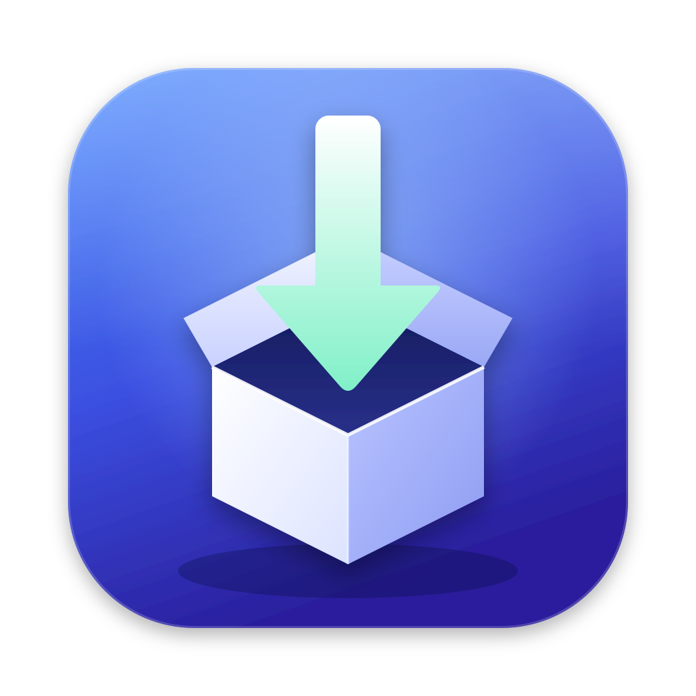

<p align="center"></p>

# SUS Fetcher

🇬🇧 [English version](README.md)

App macOS native (Swift/SwiftUI, Apple Silicon, macOS 14+, sans aucune dépendance) qui lit le catalogue Apple Software Update et télécharge `InstallAssistant.pkg` **en un clic**, sans passer par clic droit → Packages → InstallAssistant.pkg.

## Origine et crédits

- **Inspiré de [SUS Inspector](https://github.com/hjuutilainen/sus-inspector)** de Hannes Juutilainen. Le concept (parcourir le catalogue Apple Software Update et en extraire les paquets) vient de là. SUS Inspector reposant sur Python 2 / PyObjC, SUS Fetcher en est une réécriture complète et moderne, centrée sur le téléchargement des installers macOS. Aucun code de SUS Inspector n'a été repris.
- **La majorité du code a été écrite par [Claude](https://claude.ai) (Anthropic)**.

## Fonctions

- Sidebar **Installers macOS** / **Autres** / **Téléchargements** (⌘1 / ⌘2 / ⌘3)
- Bouton « InstallAssistant.pkg » par ligne, double-clic, multi-sélection (clic droit)
- Page Téléchargements + mini-moniteur en bas de la sidebar : progression, vitesse, temps restant, **pause / reprise**, annulation, réessai
- Confirmation avant de quitter si des téléchargements sont en cours
- Produits « Autres » : menu des paquets, rangés dans `<Titre> <version> [<Product ID>]/`
- Canaux : Public, Bêta publique, Bêta développeur, AppleSeed — produits bêta marqués BÊTA, filtre « Bêtas uniquement »
- Recherche par titre / version / build / Product ID
- Métadonnées (.dist) mises en cache dans `~/Library/Application Support/SUSFetcher/`

## Réglages (⌘,)

- **Langue** : système / français / English (changement immédiat)
- **Apparence** : système / clair / sombre
- **Dossier de téléchargement** par défaut
- **Nommage des installers** : préréglages ou modèle personnalisé, avec aperçu

| Préréglage | Exemple |
|---|---|
| Nom Apple d'origine | `InstallAssistant.pkg` |
| InstallAssistant + version + build | `InstallAssistant-26.7.1-25H123.pkg` |
| Lisible (défaut) | `InstallermacOSTahoe-26.7.1.pkg` |
| Lisible + build | `InstallermacOSTahoe-26.7.1-25H123.pkg` |

Jetons du modèle personnalisé : `{name}` (titre sans espaces), `{title}`, `{version}`, `{build}`, `{id}`.
Un jeton vide est supprimé avec son séparateur.

## Installation

Télécharger la dernière version dans les [Releases](https://github.com/Matt-uSk/SUSFetcher/releases), décompresser et glisser **SUS Fetcher.app** dans `/Applications`.

L'app est signée ad-hoc (pas de Developer ID Apple) : au premier lancement macOS la bloque. Retirer la quarantaine une fois :

```bash
xattr -dr com.apple.quarantine "/Applications/SUS Fetcher.app"
```

Apple Silicon, macOS 14 ou plus récent.

## Build depuis les sources

```bash
chmod +x build-app.sh
./build-app.sh 1.0.0      # → build/SUS Fetcher.app
```

Ou pour tester rapidement : `swift run`. Ou `open Package.swift` pour l'ouvrir dans Xcode.

## Versions futures de macOS

Rien à modifier ni à recompiler. Au lancement, SUS Fetcher détecte la dernière version majeure publiée par Apple : il part de la plus haute version connue (version du Mac, dernière détection, ou 27) et teste les catalogues suivants jusqu'au premier 404. Le résultat est mémorisé, et visible dans la barre de statut et les réglages.

Le catalogue public contient de toute façon les nouveaux installers (Apple les ajoute aussi aux anciens catalogues) ; la détection sert surtout aux canaux bêta, dont l'URL inclut le numéro de version. En dépannage, une URL de catalogue personnalisée peut être saisie dans les réglages.

## Publier une version

La GitHub Action [`release.yml`](.github/workflows/release.yml) compile l'app sur un Mac Apple Silicon et l'attache à une Release. Deux façons de la lancer :

- **Actions → Release → Run workflow**, en saisissant la version (ex. `v1.1.0`) : le tag et la Release sont créés automatiquement.
- Ou pousser un tag :

```bash
git tag v1.1.0 && git push origin v1.1.0
```

## Licence

[MIT](LICENSE) — fais-en ce que tu veux.

